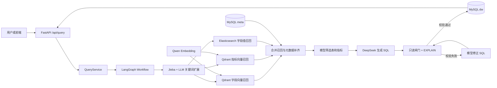
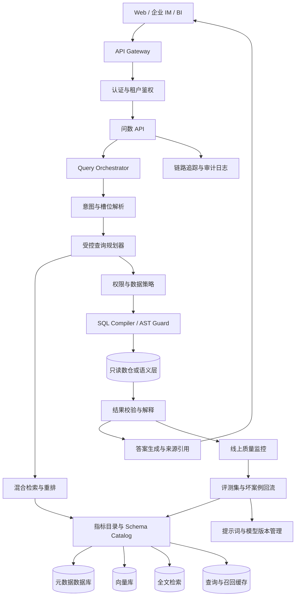

# 青竹峰大衍智能问数

## 生产级架构与实现方案

这份文档回答四个问题：当前项目的架构是什么，代码是怎样落地的，现在运行能看到什么，距离企业生产级问数还要补什么。

当前代码适合项目演示、技术验证和小规模验证。生产级系统需要在它的基础上增加权限、指标治理、SQL 安全、稳定性、评测和运维体系。

---

## 一、项目要解决的问题

业务人员通常会问：

```text
去年华东地区销售额最高的三个品牌是什么？
黄金会员的平均订单金额是多少？
每个季度的销售额趋势怎么样？
```

系统需要把自然语言转成可审计的查询过程：

```text
理解问题
→ 找到指标、维度、时间和过滤条件
→ 找到真实表和字段
→ 按业务口径生成查询
→ 校验权限和 SQL 安全
→ 查询数据
→ 解释结果和数据口径
```

问数系统的难点在于“查得出来”只是最低要求。企业真正关心的是结果是否符合指标口径，用户是否有权限，SQL 是否安全，错误能不能定位，数据变化后结果是否仍然稳定。

---

## 二、总体架构

### 2.1 当前项目架构



当前项目把模型放在几个受控节点里，流程由代码连接。模型不能跳过元数据直接访问数据库。

### 2.2 生产级架构



生产系统要把“模型输出文本”提升为“受控的查询计划”。模型只产生候选意图和候选条件，程序把这些候选映射成白名单内的指标、维度、过滤器和 SQL AST。

---

## 三、各模块的实现方案

### 3.1 接入层

当前实现是 FastAPI 的 `POST /api/query`，请求体只有一个 query 字段。

生产接口建议带上这些信息：

```json
{
  "query": "去年华东地区销售额最高的三个品牌",
  "tenant_id": "tenant_001",
  "user_id": "user_1001",
  "session_id": "session_abc",
  "locale": "zh-CN",
  "client": "web"
}
```

接入层负责：

```text
认证和登录态校验
限流和请求大小限制
幂等请求编号
租户和用户上下文
SSE 或异步任务响应
```

不要让下游节点自己从请求头猜用户身份。身份、部门、角色和租户应在入口处解析后放入不可被模型修改的运行时上下文。

### 3.2 意图与槽位解析

当前项目的第一步是 Jieba 关键词提取，三个召回节点再用模型扩展检索词。生产版本建议增加显式结构化解析：

```json
{
  "intent": "ranking",
  "metric": "GMV",
  "dimensions": ["brand"],
  "filters": [
    {"field": "region_name", "operator": "=", "value": "华东"},
    {"field": "year", "operator": "=", "value": 2025}
  ],
  "order": {"field": "GMV", "direction": "desc"},
  "limit": 3,
  "time_granularity": null,
  "confidence": 0.92
}
```

这个结构要通过 Pydantic 或 JSON Schema 校验。时间、数量、排序方向、操作符和指标名称都要做类型与枚举检查。

推荐分层：

```text
确定表达      规则和时间解析器处理
稳定意图      分类模型或轻量模型处理
复杂口语      大模型结构化解析
低置信度      澄清问题，不直接查询
```

### 3.3 指标目录

生产级问数的中心不是向量库，而是指标目录。一个指标至少需要维护：

```text
指标编码
指标中文名和别名
业务定义
计算公式
默认聚合方式
时间口径
粒度
来源表和字段
过滤规则
负责人
版本
生效时间
适用租户或部门
```

例如 GMV 不能只写“订单金额总和”，还要明确：

```text
是否包含退款
使用支付时间还是下单时间
是否排除取消订单
按订单还是订单明细去重
金额单位和币种
```

当前项目的 `metric_info` 已经提供了名称、描述、别名和关联字段。生产版本要把它扩展成可审核、可发布、可回滚的指标版本。

### 3.4 Schema Catalog

Schema Catalog 负责保存可供 Agent 使用的表和字段信息。除了当前的表信息、字段信息、主外键和字段样例，生产版本还应保存：

```text
表和字段的负责人
数据更新时间
数据粒度
敏感级别
可用租户
是否允许聚合
是否允许作为过滤条件
字段弃用状态
表关联基数
```

目录发布流程建议为：

```text
读取数据库 Schema
→ 数据工程师补业务解释
→ 指标负责人审核
→ 生成 MySQL、ES、向量库索引
→ 运行回归问题集
→ 发布一个目录版本
```

### 3.5 混合检索

生产级召回建议采用以下顺序：

```text
关键词检索召回候选
向量检索召回语义候选
元数据过滤掉无权限和已下线字段
重排模型按问题和 Schema 相关性排序
按阈值和 TopK 截断
```

不同信息使用不同策略：

| 信息 | 首选检索 | 原因 |
|---|---|---|
| 字段名称和描述 | 向量 + 关键词 | 需要理解同义表达 |
| 指标定义 | 向量 + 版本过滤 | 需要找到正确业务口径 |
| 地区、品牌、客户名 | 全文检索 + 别名表 | 必须确认真实值存在 |
| 权限和状态 | 结构化数据库 | 不能靠相似度决定 |

检索结果要带来源、分数、索引版本和命中的文本，便于后续解释和排错。

### 3.6 查询规划器

生产版本应让模型先生成查询计划，再由程序编译 SQL。计划可以包含：

```text
使用哪个指标
按什么维度分组
过滤条件
时间范围
排序和 TopK
是否需要 JOIN
结果展示字段
```

程序根据目录中的指标模板和字段白名单生成 SQL。这样模型负责业务意图，SQL 结构由编译器掌控，能明显减少幻觉和危险语句。

当前项目直接让 DeepSeek 输出一条 SQL，适合展示主流程。生产改造时，建议保留当前 `generate_sql` 作为降级路径，但默认走结构化计划编译。

### 3.7 SQL 安全层

生产级 SQL 执行至少需要五道门：

```text
第一道  只读账号
第二道  SQL AST 解析
第三道  表、字段和函数白名单
第四道  租户、部门和行级权限条件
第五道  超时、扫描行数和返回行数限制
```

当前版本已经增加了依赖无关的只读 SQL 闸门，拦截写操作、多语句和非 SELECT/WITH 查询。它仍然属于基础保护，生产环境建议使用成熟 SQL Parser，并对 `JOIN`、子查询、函数、表名和字段名做精确检查。

### 3.8 结果校验与回答生成

查询结果返回前建议做三类检查：

```text
结构检查  字段、数据类型和行数是否符合计划
业务检查  是否出现负数、空结果、异常极值或重复聚合
口径检查  指标版本、时间范围和过滤条件是否一致
```

回答生成时要带上：

```text
最终数值
统计时间
筛选条件
指标口径
数据更新时间
来源指标和表
```

当结果为空时，系统要区分“条件下没有数据”“数据尚未同步”“没有权限”和“字段值不存在”，不能统称为查询失败。

---

## 四、当前项目的运行效果

当前本地版本已经验证过完整链路。

### 4.1 查询示例一

输入：

```text
统计华东地区销售额最高的三个商品
```

经过的阶段：

```text
提取关键字
召回字段取值
召回字段
召回指标
合并召回信息
过滤指标
过滤表信息
添加额外上下文
生成 SQL
校验 SQL
执行 SQL
```

返回结果：

```text
Galaxy S24 Ultra  28497
Mate 60 Pro       27996
iPhone 15 Pro     17998
```

### 4.2 查询示例二

输入：

```text
平均订单金额是多少
```

返回：

```text
AOV = 2427.473913043478
```

### 4.3 当前数据量

```text
dim_region    6 行
dim_customer  20 行
dim_product   15 行
dim_date      90 行
fact_order    115 行
```

这套数据适合验证流程和学习代码，不代表生产数据规模。生产环境的事实表通常会进入数仓、湖仓或查询引擎，不能让 API 服务直接承担大表全量扫描。

---

## 五、生产部署拓扑

### 5.1 小规模内部系统

```text
Nginx / API Gateway
  → 2 个 FastAPI 实例
  → Redis，保存短期会话和缓存
  → MySQL 元数据主库
  → 只读数仓账号
  → ES 集群
  → Qdrant 集群
  → 外部 LLM 和 Embedding 服务
```

API 实例不保存本地状态。请求上下文、缓存、任务状态和限流计数放在 Redis 或数据库中，这样实例才能水平扩展。

### 5.2 中大型系统

```text
用户请求
  → API Gateway
  → Query Orchestrator
  → 查询计划队列
  → SQL 编译和策略服务
  → 语义层或 OLAP 查询引擎
  → 结果缓存和审计库
```

元数据构建、Embedding、索引更新和评测应该做成独立异步任务，不能阻塞在线查询服务。

### 5.3 关键高可用策略

```text
LLM 和 Embedding 调用设置连接超时、读取超时和重试上限
外部服务重试使用指数退避和随机抖动
ES、Qdrant 和数据库设置健康检查
SQL 查询设置 statement timeout
查询结果设置最大行数和最大字节数
缓存命中时跳过重复召回
关键配置和指标目录做版本化备份
```

---

## 六、生产级权限方案

权限要分三层。

### 6.1 接口权限

认证系统确认用户是谁，租户和部门是什么，是否可以使用问数功能。

### 6.2 目录权限

元数据目录判断用户能否看到某张表、某个字段和某个指标。没有权限的字段不能进入召回结果，避免模型先看到再尝试使用。

### 6.3 数据权限

数据库或语义层最终执行行级过滤。例如华东部门只能看到自己的区域数据，程序为查询计划绑定不可被模型修改的条件。

```text
用户身份 → 权限服务 → 允许的表和字段
                    → 固定行级过滤条件
                    → SQL 编译器
                    → 只读查询账号
```

权限条件必须由程序注入，不能让大模型生成。模型可以建议筛选条件，不能决定用户能不能看。

---

## 七、生产级评测和监控

### 7.1 离线评测集

评测集应覆盖：

```text
简单聚合
地区、品牌、客户筛选
时间范围和时间粒度
排序和 TopK
多表 JOIN
同义词和口语表达
指标歧义
无数据和未知字段
无权限问题
恶意 SQL 输入
```

每条用例保存：

```json
{
  "question": "华东地区销售额最高的三个商品",
  "expected_intent": "ranking",
  "expected_metric": "GMV",
  "expected_tables": ["fact_order", "dim_product", "dim_region"],
  "expected_result": [
    {"product_name": "Galaxy S24 Ultra", "total_sales": 28497}
  ]
}
```

### 7.2 线上指标

系统指标：

```text
QPS、P50/P95/P99 延迟、超时率、错误率、资源使用率
```

Agent 指标：

```text
字段召回命中率、指标召回命中率、空召回率、SQL 校验失败率、修正成功率
```

业务指标：

```text
结果正确率、用户采纳率、不认可率、转人工率、重复追问率
```

成本指标：

```text
每次请求模型调用数、输入输出 Token、Embedding 数量、平均成本
```

### 7.3 一次线上问题怎样被定位

```text
request_id
  → 原始问题
  → 用户和租户
  → 模型版本和提示词版本
  → 检索索引版本
  → 召回候选和分数
  → 查询计划
  → SQL 哈希和执行计划
  → 结果摘要
  → 用户反馈
```

日志中不要保存完整密钥、敏感个人信息和不必要的业务明细。SQL 审计记录可以保存脱敏后的 SQL、表名、字段名、耗时和结果摘要。

---

## 八、实现路线

### 阶段一，当前学习版

```text
FastAPI 接口
LangGraph 固定工作流
MySQL 业务库和元数据库
Qdrant 字段和指标检索
ES 字段值检索
DeepSeek SQL 生成
EXPLAIN 校验
SSE 阶段输出
```

### 阶段二，稳定版

```text
结构化意图和槽位输出
指标目录版本化
SQL 修正后的二次校验
只读账号和 SQL AST 闸门
评测脚本和固定回归集
Redis 缓存
节点耗时和 Token 统计
```

### 阶段三，企业版

```text
统一认证和租户隔离
字段级和行级权限
语义层或查询服务
数据更新时间和质量校验
混合检索加重排
灰度发布和模型版本管理
链路追踪、告警和审计
查询结果解释与来源引用
```

### 阶段四，规模化版

```text
查询计划 DSL
SQL 编译器
异步查询队列
OLAP 引擎
结果缓存和预聚合
多模型路由
自动坏案例回流
指标负责人审核流程
```

---

## 九、生产化升级说明

项目对外介绍时，可以这样描述生产化升级：

```text
当前项目先用 LangGraph 把问数链路跑通，模型负责关键词扩展、字段和指标筛选以及 SQL 生成，MySQL 元数据、ES 和 Qdrant 提供受控依据。要做生产级版本，我会把自然语言解析结果收敛成查询计划，再由指标目录和 SQL 编译器生成 SQL。入口增加租户鉴权，目录层做字段和指标权限，执行层使用只读账号、SQL AST 白名单、行级策略、超时和返回行数限制。线上通过 request_id 追踪原问题、召回、计划、SQL 和结果，离线评测集持续测召回率、SQL 正确率和结果一致率，坏案例回流到提示词、元数据和回归集。这样系统的核心目标就从“能生成 SQL”变成“结果正确、权限正确、过程可审计、问题可定位”。
```

关于模型选择，还需要明确一个工程判断：

```text
更强模型只能改善理解和生成，不能替代指标治理、权限系统、只读数据库和结果校验。生产稳定性来自模型、数据目录、程序约束和评测闭环一起工作。
```

---

## 十、当前版本和生产版本的差别

| 能力 | 当前版本 | 生产版本目标 |
|---|---|---|
| 解析 | Jieba 加模型扩展 | 结构化意图、槽位和置信度 |
| 指标 | YAML 配置和 MySQL 元表 | 版本化指标目录和审核发布 |
| 检索 | Qdrant 加 ES | 混合检索、重排、权限过滤 |
| SQL | 模型直接生成文本 SQL | 查询计划加 SQL 编译器 |
| 安全 | 只读闸门和 EXPLAIN | AST、白名单、行级策略、只读账号 |
| 修正 | 有限次数重新校验 | 可解释重试和人工兜底 |
| 权限 | 需要继续补充 | 租户、字段级、行级完整策略 |
| 评测 | 基础问题集和脚本 | 标准答案、灰度门禁和坏案例回流 |
| 运维 | 本地 Docker 和日志 | 集群、追踪、告警、审计和备份 |
| 数据规模 | 小型示例数据 | OLAP、缓存、预聚合和查询配额 |

