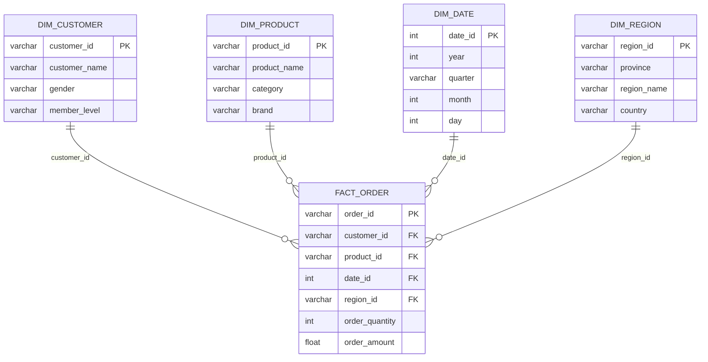
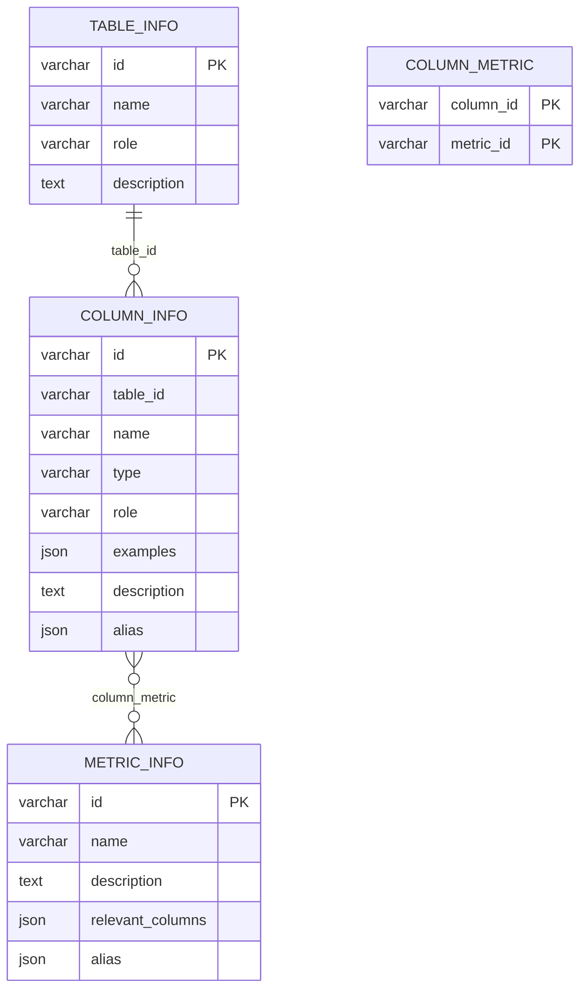
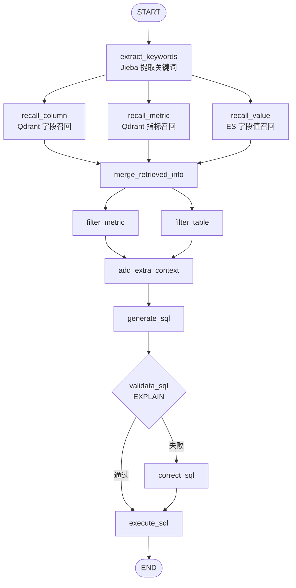

# 青竹峰大衍智能问数项目 Wiki

这份 Wiki 对应当前目录里的可运行代码。它把项目当成一个真实的工程来讲，重点放在四件事上。

1. 用户的一句话怎样变成 SQL
2. 真实业务数据、元数据、全文索引和向量索引分别放在哪里
3. LangGraph 的每个节点究竟做了什么
4. 这个项目目前能做到什么，哪里还需要继续加固

阅读时建议先看项目总链路，再看数据模型，最后按一次请求的顺序读代码。只从某一个节点开始读，很容易把“字段召回”“表筛选”和“SQL 生成”混在一起。

## 0. 当前运行状态

当前环境已经实际启动并验证过：

```text
FastAPI       http://127.0.0.1:8000
MySQL         127.0.0.1:3306
Elasticsearch 127.0.0.1:9200
Qdrant        127.0.0.1:6333
```

Qwen Embedding 已返回 1024 维向量，元数据已经写入 MySQL、Elasticsearch 和 Qdrant。接口实测通过了两条问题：

```text
统计华东地区销售额最高的三个商品
平均订单金额是多少
```

前一个问题返回了 Galaxy S24 Ultra、Mate 60 Pro 和 iPhone 15 Pro 的销售额排行，后一个问题返回 AOV 约 2427.47。打开 [API 文档](http://127.0.0.1:8000/docs) 可以继续提问。

---

## 1. 项目定位

这是一个自然语言问数 Agent。用户可以直接问：

```text
统计华东地区销售额最高的三个商品
```

系统会把问题拆成业务条件，从元数据目录里找到可用的表和字段，再生成只读 SQL，执行后把结果以流式事件返回。

项目的核心价值可以这样理解：

```text
人话问题
  ↓
提取关键词、指标和业务值
  ↓
检索字段、指标、字段取值和表结构说明
  ↓
筛出本次问题真正需要的 Schema
  ↓
生成 SQL
  ↓
EXPLAIN 校验，失败时让模型修正
  ↓
查询业务库
  ↓
通过 SSE 返回处理阶段和结果
```

当前项目采用受控的 Workflow 型 Agent。LangGraph 的节点和边由代码确定，大模型负责语义理解、候选筛选和 SQL 生成，数据库访问和流程顺序由程序掌控。它没有让模型自由创建工具、自由跳转流程或无限循环。

### 技术栈

| 层次 | 技术 | 在项目中的作用 |
|---|---|---|
| Web 接入 | FastAPI | 提供 `/api/query` 和 Swagger 文档 |
| 工作流 | LangGraph | 编排节点、状态和条件路由 |
| 对话模型 | DeepSeek Chat | 关键词扩展、候选筛选、SQL 生成和 SQL 修正 |
| 向量模型 | Qwen `text-embedding-v3` | 将字段和指标语义转成 1024 维向量 |
| 关系数据库 | MySQL 8 | 保存业务数据和元数据 |
| 全文检索 | Elasticsearch 8.19 + IK | 检索“华东”“苹果”等具体字段取值 |
| 向量数据库 | Qdrant 1.16 | 检索语义相近的字段和指标 |
| ORM/数据库访问 | SQLAlchemy 2 + asyncmy | 异步连接 MySQL、执行 EXPLAIN 和查询 |
| 配置 | OmegaConf + YAML | 管理数据库、模型、表和指标配置 |
| 日志 | Loguru | 输出带 request id 的链路日志 |
| 容器 | Docker Compose | 启动 MySQL、ES、Qdrant、Kibana 等依赖 |

---

## 2. 目录地图

下面是当前项目中真正参与运行的主要目录。

```text
大衍智能问数项目/
├── main.py                         FastAPI 应用入口
├── pyproject.toml                  Python 依赖和项目元信息
├── uv.lock                         依赖锁定文件
├── app/
│   ├── agent/
│   │   ├── graph.py                LangGraph 图定义
│   │   ├── state.py                工作流状态结构
│   │   ├── context.py              运行时依赖结构
│   │   ├── llm.py                  DeepSeek LangChain 模型
│   │   └── nodes/                  每个工作流节点
│   ├── api/
│   │   ├── dependencies.py         FastAPI 依赖注入
│   │   ├── routers/query_router.py 查询接口
│   │   └── schemas/query_schema.py 请求体模型
│   ├── clients/                    外部服务客户端管理器
│   ├── conf/                       Python 配置数据类
│   ├── core/
│   │   ├── lifespan.py             应用启动和关闭
│   │   ├── context.py              request id 上下文变量
│   │   └── log.py                  Loguru 日志配置
│   ├── models/                     MySQL、ES、Qdrant 数据结构
│   ├── prompt/prompt_loader.py     从 prompts 目录读取提示词
│   ├── repositories/               对数据库和索引的访问封装
│   ├── scripts/build_meta_knowledge.py  构建元数据知识库
│   └── services/
│       ├── query_service.py        一次问数请求的服务入口
│       └── meta_knowledge_service.py  元数据同步和索引构建
├── conf/
│   ├── app_config.yaml             运行环境配置
│   ├── meta_config.yaml            表、字段、指标目录配置
│   └── text_config.yaml            练习用配置
├── docker/
│   ├── docker-compose.yaml         基础设施编排
│   ├── mysql/dw.sql                业务库建表和样例数据
│   ├── mysql/meta.sql              元数据库建表脚本
│   ├── elasticsearch/              ES 镜像和 IK 插件
│   └── embedding/                 课程自带的 BGE 模型文件
├── prompts/                       所有模型提示词
├── evals/questions.json            基础评测问题集
└── docs/                           项目 Wiki 和实施方案
```

### 一次调用的代码入口

```text
main.py
  → app/api/routers/query_router.py
  → app/services/query_service.py
  → app/agent/graph.py
  → app/agent/nodes/*.py
  → repositories
  → MySQL / Elasticsearch / Qdrant / DeepSeek / Qwen
```

---

## 3. 本地运行方式

### 3.1 环境变量

当前代码会优先读取运行环境里的模型密钥。

```bash
export DEEPSEEK_API_KEY="你的 DeepSeek Key"
export ALIYUN_API_KEY="你的阿里云百炼 Key"
export QWEN_EMBEDDING_MODEL="text-embedding-v3"
```

`DEEPSEEK_API_KEY` 会覆盖 YAML 里的模型配置。`ALIYUN_API_KEY` 存在时，`EmbeddingClientManager` 使用项目里新增的 `QwenEmbeddings`，直接请求 DashScope 的文本向量接口。

### 3.2 启动基础设施

在项目根目录执行：

```bash
docker-compose -f docker/docker-compose.yaml up -d mysql elasticsearch qdrant
```

课程的 embedding 容器使用了面向 x86 的镜像。在 Apple Silicon 上可能没有 `linux/arm64` 镜像，所以当前运行方案跳过这个容器，使用 Qwen 云端 Embedding。Qdrant、ES 和 MySQL 仍然由 Docker 管理。

检查服务：

```bash
docker-compose -f docker/docker-compose.yaml ps
```

### 3.3 构建元数据知识库

业务库里已有订单、商品、客户等明细。Agent 还需要一份可检索的目录，因此要执行：

```bash
./.venv/bin/python -m app.scripts.build_meta_knowledge \
  -c conf/meta_config.yaml
```

这条命令会做四件事：

1. 从 `dw` 读取字段类型和字段样例
2. 把表、字段和指标说明写入 `meta`
3. 调用 Qwen 把字段和指标说明转成向量，写入 Qdrant
4. 把配置中 `sync: true` 的字段取值写入 Elasticsearch

课程原始脚本重复执行时会因为主键重复而失败。当前重建索引前需要清理生成的 `meta` 数据和 ES/Qdrant 索引，业务库 `dw` 不应被清理。更稳的工程版本应把构建脚本改成幂等的 upsert 或版本化构建。

### 3.4 启动 API

```bash
./.venv/bin/uvicorn main:app --host 0.0.0.0 --port 8000
```

打开 [Swagger 文档](http://127.0.0.1:8000/docs)，选择 `POST /api/query`，输入：

```json
{
  "query": "统计华东地区销售额最高的三个商品"
}
```

也可以用 curl：

```bash
curl -N -X POST http://127.0.0.1:8000/api/query \
  -H 'Content-Type: application/json' \
  -d '{"query":"统计华东地区销售额最高的三个商品"}'
```

接口返回的是 `text/event-stream`。你会先看到处理阶段，最后看到结果：

```text
data: {"stage": "提取关键字"}
data: {"stage": "召回字段取值"}
data: {"stage": "召回字段"}
data: {"stage": "召回指标"}
data: {"stage": "合并召回信息"}
data: {"stage": "过滤指标"}
data: {"stage": "过滤表信息"}
data: {"stage": "添加额外上下文"}
data: {"stage": "生成sql"}
data: {"stage": "执行sql"}
data: {"result": [{"product_name": "Galaxy S24 Ultra", "total_sales": 28497.0}]}
```

---

## 4. 数据层，先把两套库分清

项目里有两个 MySQL 数据库。

```text
dw    保存真正的业务数据，一行通常代表一笔事实记录
meta  保存给 Agent 看的数据目录，一行代表一条说明
```

可以把 `dw` 理解为书库，把 `meta` 理解为目录。Agent 先查目录，知道哪些表和字段能用，生成 SQL 后再回到书库查订单明细。

### 4.1 `dw` 业务库

它是一个小型电商问数数据集，当前包含 5 张表。

| 表 | 类型 | 一行代表什么 | 关键字段 |
|---|---|---|---|
| `fact_order` | fact | 一笔订单 | `order_id`、`order_amount`、`order_quantity` |
| `dim_product` | dim | 一个商品 | `product_id`、`product_name`、`category`、`brand` |
| `dim_customer` | dim | 一个客户 | `customer_id`、`customer_name`、`gender`、`member_level` |
| `dim_region` | dim | 一个地区 | `region_id`、`province`、`region_name`、`country` |
| `dim_date` | dim | 一个日期 | `date_id`、`year`、`quarter`、`month`、`day` |

逻辑关系如下：



当前 SQL 初始化脚本主要依靠字段命名约定表达这些关联，没有在 MySQL 中声明显式的 `FOREIGN KEY` 约束。`meta_config.yaml` 通过 `role: foreign_key` 记录了这些语义，Agent 在合并表信息时会补回主键和外键字段。

### 4.2 一条订单怎样展开成完整业务信息

`fact_order` 中有一行：

```text
order_id       = ORD20250101001
customer_id    = C001
product_id     = P001
date_id        = 20250101
region_id      = R001
order_quantity = 1
order_amount   = 8999
```

沿着四个 ID 查询维度表后，可以得到：

```text
C001      → 李伟，男，黄金会员
P001      → iPhone 15 Pro，手机数码，苹果
20250101 → 2025 年 1 月 1 日
R001      → 广东省，华南，中国
```

所以订单事实表保存“发生了什么”和“金额是多少”，维度表保存“这个 ID 具体是谁、是什么、属于哪里”。

### 4.3 一个真实问数 SQL

用户问“华东地区销售额最高的三个商品”，需要从事实表取金额，从地区表过滤华东，从商品表显示商品名称。

```sql
SELECT
    p.product_name,
    SUM(o.order_amount) AS total_sales
FROM fact_order o
JOIN dim_product p
    ON o.product_id = p.product_id
JOIN dim_region r
    ON o.region_id = r.region_id
WHERE r.region_name = '华东'
GROUP BY p.product_name
ORDER BY total_sales DESC
LIMIT 3;
```

这条 SQL 体现了问数的基本结构：

```text
事实表提供指标
维度表提供筛选条件和展示名称
JOIN 通过 ID 把它们拼起来
GROUP BY 决定统计粒度
ORDER BY 和 LIMIT 处理排行
```

### 4.4 `meta` 元数据库

`meta` 里有四张表。

| 表 | 存什么 | 例子 |
|---|---|---|
| `table_info` | 表的用途、类型、说明 | `fact_order` 是订单事实表 |
| `column_info` | 字段名称、类型、角色、样例、别名和说明 | `order_amount` 表示订单金额 |
| `metric_info` | 指标名称、口径、别名、关联字段 | GMV 等于订单金额总和 |
| `column_metric` | 指标与字段的关联 | GMV 关联 `fact_order.order_amount` |

元数据表保存的是“怎么理解业务数据”，不保存 115 笔订单明细。当前构建后大致是：

```text
table_info      5 行
column_info     24 行
metric_info     2 行
column_metric   2 行
```

元数据关系可以画成：



### 4.5 指标口径

当前配置有两个指标。

```yaml
GMV:
  description: 所有订单的成交金额总和
  relevant_columns:
    - fact_order.order_amount

AOV:
  description: 所有订单的成交金额平均值
  relevant_columns:
    - fact_order.order_amount
```

这里的 `relevant_columns` 只告诉系统指标依赖哪些字段，真正的聚合方式仍由指标描述和 SQL 提示词共同约束。AOV 原始课程配置曾经错误关联到 `order_quantity`，当前版本已经改成 `order_amount`。

---

## 5. 三种检索数据放在哪里

项目没有把所有订单明细搬进向量库。每种存储各有自己的任务。

```text
MySQL dw
  保存订单、商品、客户、地区、日期等精确业务数据

MySQL meta
  保存表、字段、指标的结构化目录

Qdrant
  保存字段名称、字段描述、字段别名、指标名称和指标描述的向量

Elasticsearch
  保存需要精确匹配的字段取值，例如华东、苹果、黄金
```

### 5.1 Qdrant 保存什么

`MetaKnowledgeService` 会为每个字段生成多条向量文本：

```text
字段名       order_amount
字段描述     订单金额
字段别名     销售额
```

这些文本分别调用 Qwen Embedding，再写入 `data-agent-column` 集合。每条向量的 payload 仍然带着完整字段对象，例如字段 ID、表 ID、类型、角色、样例、描述和别名。

指标也有自己的 `data-agent-metric` 集合，写入指标名、指标描述和指标别名。

Qdrant 解决的是语义相似问题。用户说“成交额”，即使数据库字段叫 `order_amount`，也有机会通过向量相似度找到它。

### 5.2 Elasticsearch 保存什么

配置里 `sync: true` 的字段值会写入 `data-agent-values` 索引。当前适合放进去的值包括：

```text
华东、华南、广东省、上海市
苹果、华为、戴森
黄金、白银、铂金
商品名称、客户名称、品牌、品类
```

ES 解决的是字段取值问题。用户问“华东”时，系统要知道“华东”真实出现在 `dim_region.region_name`，而不是让模型自己猜一个地区字段。

### 5.3 为什么要两种检索

字段名和指标说明更适合语义检索，字段真实取值更适合全文检索。两类结果合并后，系统再回到元数据库补齐表结构和主外键。

```text
问题中的“销售额”
  → Qdrant 找 order_amount 和 GMV

问题中的“华东”
  → ES 找到 dim_region.region_name

召回结果
  → meta.column_info 补齐字段类型、角色、主外键和描述
```

---

## 6. 元数据知识库构建流程

入口是 `app/scripts/build_meta_knowledge.py`，核心服务是 `MetaKnowledgeService`。

### 第一步，读取配置

`conf/meta_config.yaml` 手工定义每张表、每个字段和每个指标的业务说明。它弥补了数据库 `SHOW COLUMNS` 只能告诉系统字段名和类型的不足。

一个字段配置包含：

```yaml
- name: order_amount
  role: measure
  description: 订单金额。
  alias: [销售额, 订单金额, 收入]
  sync: false
```

### 第二步，从业务库读取字段类型和样例

`DwMysqlRepository.get_column_types()` 执行 `SHOW COLUMNS FROM 表名`，拿到真实数据库类型。`get_column_values()` 执行 `SELECT DISTINCT 字段 LIMIT N`，拿到字段样例。

这样做有两个好处：

1. 配置里的说明和真实数据库类型保持一致
2. 模型看到字段样例后，更容易理解枚举值和业务实体

### 第三步，写入 `meta`

服务会创建 `TableInfoMySQL`、`ColumnInfoMySQL`、`MetricInfoMySQL` 和 `ColumnMetricMySQL` 对象，通过 SQLAlchemy 批量写入元数据库。

### 第四步，生成 Qdrant 向量

字段名、字段描述和别名分别调用 `aembed_documents()`。当前 Qwen 客户端每批发送 10 条文本，Qdrant 集合的向量维度由 `app_config.qdrant.embedding_size` 控制，当前是 1024。

### 第五步，生成 ES 字段值索引

只有 `sync: true` 的字段才会写入 ES。每条 ES 文档保存字段值以及它所属的表和字段。

---

## 7. LangGraph 状态与运行时依赖

### 7.1 `DataAgentState`

状态会沿着图在节点之间传递，主要字段如下。

| 状态字段 | 内容 | 产生节点 |
|---|---|---|
| `query` | 用户原始问题 | API 初始化 |
| `keywords` | Jieba 和模型扩展后的关键词 | `extract_keywords` |
| `recall_columns` | Qdrant 召回的字段对象 | `recall_column` |
| `recall_metric` | Qdrant 召回的指标对象 | `recall_metric` |
| `recall_values` | ES 召回的字段值对象 | `recall_value` |
| `table_infos` | 按表组织的候选 Schema | `merge_retrieved_info`、`filter_table` |
| `metric_infos` | 候选指标 | `merge_retrieved_info`、`filter_metric` |
| `date_info` | 当前日期、星期、季度 | `add_extra_context` |
| `db_info` | 数据库版本和方言 | `add_extra_context` |
| `sql` | 当前 SQL 字符串 | `generate_sql`、`correct_sql` |
| `error` | SQL 校验错误 | `validata_sql` |

### 7.2 `DataAgentContext`

Context 保存一次运行需要的客户端和 Repository。它不会随着模型推理结果变化。

```text
embedding_client
column_qdrant_repository
metric_qdrant_repository
value_es_repository
meta_mysql_repository
dw_mysql_repository
```

可以用一句话区分：State 是这次问题已经得到的中间结果，Context 是这次运行可以调用的工具和连接。

---

## 8. 一次请求的完整工作流

`app/agent/graph.py` 用 `StateGraph` 声明节点和边。



三个召回分支在逻辑上并行。LangGraph 会等它们都写回状态后，才进入 `merge_retrieved_info`。

### 8.1 `extract_keywords`

文件：`app/agent/nodes/extract_keywords.py`

这一步使用 `jieba.analyse.extract_tags()` 做轻量关键词提取，只保留一批业务上比较有用的词性，例如名词、地名、动词和英文词。随后把完整原问题也加入关键词集合，避免分词丢掉完整语义。

输入：

```text
统计华东地区销售额最高的三个商品
```

可能得到：

```text
华东、销售额、最高、商品、统计、原问题全文
```

这一节点没有直接让大模型做完整意图分类。它先提供一个便宜、可解释的关键词起点，后续的三个召回节点再分别做自己的语义扩展。

### 8.2 `recall_column`

文件：`app/agent/nodes/recall_column.py`

流程如下：

1. 用 `extend_keywords_for_column_recall.prompt` 让 DeepSeek 生成字段概念，例如“销售额”对应“金额字段”，“商品”对应“商品名称字段”。
2. 将 Jieba 关键词和模型扩展结果合并去重。
3. 每个关键词调用 Qwen Embedding。
4. 使用余弦相似度在 Qdrant 的 `data-agent-column` 集合里搜索。
5. 按字段 ID 去重。

模型被要求只输出字段语义，不输出具体取值、表名或 SQL。这种限制让字段召回和字段值召回保持边界。

### 8.3 `recall_metric`

文件：`app/agent/nodes/recall_metric.py`

它和字段召回类似，但搜索目标是指标概念。用户说“销售额”“成交总额”“GMV”时，目标是找到 `GMV` 指标及其关联字段，而不是直接把这些词当作数据库列名。

### 8.4 `recall_value`

文件：`app/agent/nodes/recall_value.py`

这一步调用 `extend_keywords_for_value_recall.prompt`，把问题里的实体和枚举值提出来，然后在 ES 的 `value` 字段上做全文匹配。

例如：

```text
用户问题中的“华东”
  → ES 文档 value=华东
  → column_id=dim_region.region_name
  → table_id=dim_region
```

它的结果带着字段 ID，因此后面可以反查 `meta.column_info`，把具体取值接回字段定义。

### 8.5 `merge_retrieved_info`

文件：`app/agent/nodes/merge_retrieved_info.py`

这是检索阶段最关键的整合节点。

它做四件事：

1. 以 Qdrant 召回字段为基础建立字段字典
2. 如果召回的指标依赖某字段，但该字段没有被直接召回，就从 `meta` 补回来
3. 如果 ES 找到一个字段值，但字段信息尚未进入召回集合，也从 `meta` 补回来，并把该值加入字段样例
4. 按表分组字段，再补齐每张表的主键和外键

补主外键很重要。模型可能只通过语义召回了 `order_amount` 和 `region_name`，但生成 JOIN 还需要 `fact_order.region_id` 和 `dim_region.region_id`。代码通过 `get_column_keys_by_table_id()` 把这些连接字段加回候选 Schema。

最后，它把字段对象转换成 `TableInfoState`，并把指标对象转换成 `MetricInfoState`。

### 8.6 `filter_metric`

文件：`app/agent/nodes/filter_metric.py`

Qdrant 返回的是相似候选，候选里可能有 GMV 和 AOV。这个节点把候选指标和用户问题一起交给 DeepSeek，让模型只返回本次真的要统计的指标名称。

规则要求：

```text
只能从召回候选中选择
不需要指标时返回 []
只保留最小指标集合
不生成 SQL
```

### 8.7 `filter_table`

文件：`app/agent/nodes/filter_table.py`

它把候选表和字段裁剪成生成 SQL 所需的最小 Schema。例如只保留：

```json
{
  "fact_order": ["order_amount", "product_id", "region_id"],
  "dim_product": ["product_id", "product_name"],
  "dim_region": ["region_id", "region_name"]
}
```

模型只能从输入候选中选择表和字段，不能临时编造表名或字段名。字段裁剪能减少 SQL 提示词长度，也能降低模型看到无关字段后选错的概率。

### 8.8 `add_extra_context`

文件：`app/agent/nodes/add_extra_context.py`

它给 SQL 生成补两类环境信息：

```text
date_info  当前日期、星期、季度
db_info    MySQL 版本和数据库方言
```

当前日期可以帮助模型理解“今年”“本季度”等表达。数据库方言可以让模型选择符合 MySQL 的语法。

### 8.9 `generate_sql`

文件：`app/agent/nodes/generate_sql.py`

它把以下内容序列化成 YAML，放进 `generate_sql.prompt`：

```text
用户问题
裁剪后的表和字段
候选指标定义
时间上下文
数据库版本和方言
```

提示词要求模型：

1. 只能使用提供的表和字段
2. 遵循指标口径
3. 只生成查询 SQL
4. 只输出一条纯 SQL
5. 不输出 Markdown 代码块

这里用 `StrOutputParser`，所以结果仍然是文本。当前项目没有用结构化 SQL AST 或 Pydantic 模型承接 SQL。

### 8.10 `validata_sql`

文件：`app/agent/nodes/validata_sql.py`

节点调用 `DwMysqlRepository.validate_sql()`，实际执行：

```sql
EXPLAIN <模型生成的 SQL>
```

如果 EXPLAIN 成功，写回 `error: None`，图路由到 `execute_sql`。如果失败，写回错误字符串，图路由到 `correct_sql`。

代码里的事件名称仍写成“过滤表信息”，这是一个显示文案问题，实际职责是 SQL 校验。

### 8.11 `correct_sql`

文件：`app/agent/nodes/correct_sql.py`

它把原 SQL、数据库错误、用户问题、Schema、指标和数据库信息交给修正提示词，让模型在保持业务语义的前提下修复语法或字段问题。

当前图在 `correct_sql` 后直接进入 `execute_sql`。这意味着修正后的 SQL 没有再次经过 `validata_sql`。生产版本应改成：

```text
correct_sql
  → validata_sql
  → 成功才 execute_sql
  → 失败达到次数上限后结束
```

### 8.12 `execute_sql`

文件：`app/agent/nodes/execute_sql.py`

它从状态读取 SQL，通过 `DwMysqlRepository.execute_sql()` 执行，再把结果写入流事件。

当前实现依赖提示词约束“只生成查询”，程序层还没有 SQL 解析器或只读账号来硬性拦截 `INSERT`、`UPDATE`、`DELETE`、`DROP` 等语句。正式环境应至少增加 SQL 类型白名单、查询超时、行数上限、表白名单和只读数据库账号。

---

## 9. 提示词体系

提示词都放在 `prompts/`，通过 `app/prompt/prompt_loader.py` 按文件名加载。

| 提示词 | 用途 | 输出格式 |
|---|---|---|
| `extend_keywords_for_column_recall` | 扩展字段概念 | JSON 数组 |
| `extend_keywords_for_metric_recall` | 扩展指标概念 | JSON 数组 |
| `extend_keywords_for_value_recall` | 扩展字段取值 | JSON 数组 |
| `filter_metric_info` | 筛选指标 | JSON 数组 |
| `filter_table_info` | 筛选表和字段 | JSON 对象 |
| `generate_sql` | 生成查询 SQL | 纯文本 SQL |
| `correct_sql` | 修正 SQL | 纯文本 SQL |
| `plan_sql` | 查询规划草稿 | 当前图没有调用 |

### 9.1 为什么检索提示词要分成三套

“销售额”是指标或度量概念，“华东”是字段取值，“商品名称”是字段概念。三者混在一个提示词里，模型很容易把“华东”当作字段名，把“销售额”当作字段取值。

当前做法把它们分开：

```text
字段召回  找应该使用哪一列
指标召回  找业务上要计算哪个指标
值召回    找问题中出现的实体落在哪一列
```

### 9.2 结构化输出的边界

字段扩展、指标扩展、字段值扩展和表筛选都使用 `JsonOutputParser`，这样下游可以直接遍历列表或字典。SQL 生成使用纯文本，是因为 SQL 还没有被封装成结构化语法树。

对外说明时可以这样解释：

```text
对候选选择和路由，要求结构化 JSON，便于程序校验。
对 SQL，当前项目先要求纯文本，再用 EXPLAIN 做执行层校验。
更稳的版本会进一步解析 SQL AST，限制表、列和语句类型。
```

---

## 10. 客户端、Repository 和服务层

### 10.1 客户端管理器

`app/clients` 只负责连接的创建和关闭。

| 文件 | 管理对象 | 初始化方式 |
|---|---|---|
| `mysql_client_manager.py` | 两个 SQLAlchemy AsyncEngine | `dw` 和 `meta` 各一个连接池 |
| `es_client_manager.py` | AsyncElasticsearch | 连接 `http://localhost:9200` |
| `qdrant_client_manager.py` | AsyncQdrantClient | 连接 `http://localhost:6333` |
| `embedding_client_manager.py` | Qwen 或课程 BGE | 有 `ALIYUN_API_KEY` 时优先 Qwen |

MySQL 使用 `pool_size=5` 和 `pool_pre_ping=True`。连接池能减少每个请求重复建立 TCP 和数据库连接的成本，`pre_ping` 用来发现已经失效的连接。

### 10.2 Repository

Repository 把节点和具体数据库 API 隔开。

```text
DwMysqlRepository
  get_column_types
  get_column_values
  get_db_info
  validate_sql
  execute_sql

MetaMysqlRepository
  save_table_infos
  save_column_infos
  save_metric_infos
  get_column_info_by_id
  get_column_keys_by_table_id
  get_table_info_by_id

ColumnQdrantRepository
  ensure_collection
  upsert_column_embeddings
  search

MetricQdrantRepository
  ensure_collection
  upsert_column_embeddings
  search_embedding

ValueEsRepository
  ensure_index
  upsert_values
  search_value
```

### 10.3 服务层

`QueryService` 不负责业务细节，它负责把依赖组装成 `DataAgentContext`，创建初始状态，然后调用 `graph.astream()`。

`MetaKnowledgeService` 负责离线或手动触发的目录构建，不参与每次用户查询的 SQL 生成。

---

## 11. FastAPI 接口和生命周期

### 11.1 应用入口

`main.py` 做三件事：

1. 创建 `FastAPI(lifespan=lifespan)`
2. 注册 `query_router`
3. 用中间件为每个请求设置 UUID request id

### 11.2 启动顺序

`app/core/lifespan.py` 在应用启动时初始化：

```text
embedding_manager.init()
qdrant_client_manager.init()
es_client_manager.init()
meta_mysql_client_manager.init()
dw_mysql_client_manager.init()
```

应用关闭时依次关闭 Qdrant、ES 和两个 MySQL 引擎。

### 11.3 依赖注入

`app/api/dependencies.py` 为每次请求创建 Repository：

```text
Qdrant 客户端 → ColumnQdrantRepository / MetricQdrantRepository
ES 客户端     → ValueEsRepository
meta Session  → MetaMysqlRepository
dw Session    → DwMysqlRepository
```

这样节点只需要从 `runtime.context` 取 Repository，不需要自己打开和关闭数据库连接。

### 11.4 SSE 为什么适合这里

一次问数会连续经过多个模型调用和检索调用，等待时间比普通 CRUD 接口更长。SSE 可以先把“提取关键词”“生成 SQL”等阶段发给前端，最后再发送结果，用户能知道请求仍在处理。

当前事件格式是：

```text
data: {"stage": "生成sql"}

data: {"result": [{"AOV": 2427.473913043478}]}
```

---

## 12. 日志和排错

`app/core/log.py` 使用 Loguru，并通过 `ContextVar` 读取请求 ID。每条日志都包含：

```text
时间
级别
request_id
模块、函数、行号
日志正文
```

排查一次错误时，应使用 request id 把这些信息串起来：

```text
原始问题
→ 提取出的关键词
→ 各路召回结果
→ 合并后的表和字段
→ 生成的 SQL
→ EXPLAIN 错误
→ 修正后的 SQL
→ 最终结果
```

当前日志文件主要在 `logs/app.log`、`app/core/logs/app.log` 和 `app/agent/logs/app.log`。生产版本建议统一日志目录，并给每次请求记录结构化 JSON，保存节点耗时和 Token 使用量。

---

## 13. 评测体系

`evals/questions.json` 当前有 7 条基础问题，覆盖：

| 类型 | 示例 | 期望观察点 |
|---|---|---|
| aggregation | 查询订单总数 | 是否正确聚合 |
| filter_sort_topk | 华东销售额最高商品 | JOIN、过滤、排序、TopK |
| group_by | 广东省各商品订单数量 | 分组字段是否正确 |
| filter_aggregation | 黄金会员总销售额 | 客户维度 JOIN |
| time_group_by | 每季度销售额 | 日期维度 JOIN 和分组 |
| unknown_metric | 不存在的火星指数 | 是否能拒答或澄清 |
| chitchat | 你好，介绍自己 | 是否能处理非问数请求 |

### 13.1 当前评测文件能测什么

它目前只是问题和期望字段的 JSON，还没有完整的自动运行器。可以先手工逐条调用 `/api/query`，记录：

```text
接口是否成功
SQL 是否能 EXPLAIN
SQL 是否能执行
结果字段是否符合 expected
结果数值是否和标准答案一致
总耗时
```

### 13.2 建议的评测维度

```text
关键词召回率
字段召回率
指标召回率
表筛选准确率
SQL 可执行率
SQL 结果正确率
未知问题拦截率
平均延迟和 P95 延迟
单次模型调用数和 Token 消耗
```

### 13.3 评测闭环

```text
固定问题集回放
  → 找到失败节点
  → 判断是提示词、元数据、检索阈值还是 SQL 问题
  → 只改一个主要因素
  → 再跑原问题集
  → 检查新问题变好时是否让旧问题退化
```

线上还应收集用户不认可的结果，把它们补进回归集。一个完整的质量判断不能只看模型分数，也要看“该查的能否查到，该拦的能否拦住”。

---

## 14. 当前版本已经做过的工程修正

### 14.1 Qwen Embedding 接入

`app/clients/embedding_client_manager.py` 增加了 `QwenEmbeddings`。当 `ALIYUN_API_KEY` 存在时：

```text
使用 DashScope 文本向量接口
默认模型 text-embedding-v3
批量请求每批 10 条
输出维度与 Qdrant 配置保持 1024
```

这样可以绕开 Apple Silicon 无法直接运行课程 embedding 镜像的问题。

### 14.2 Qdrant 本地代理兼容

本机环境中的 HTTP 代理会拦截 httpx 对 localhost 的请求。`QdrantClientManager` 现在使用 `trust_env=False`，避免把本地 Qdrant 请求送到代理。

同时，Qdrant 1.16 下 `collection_exists` 的 HEAD 请求存在兼容性问题。两个 Repository 改成通过 GET 集合列表判断集合是否存在。

### 14.3 AOV 指标配置修正

AOV 表示平均订单金额，关联字段应是 `fact_order.order_amount`。原配置写成了 `order_quantity`，当前已修正并重建元数据索引。

---

## 15. 目前的工程风险和改进顺序

这些问题不影响当前基础查询跑通，但上线前需要明确处理边界。

### 15.1 SQL 只读保护还不够硬

提示词要求只生成查询，代码执行前只做了 `EXPLAIN`。建议增加：

```text
只读数据库账号
SQL AST 解析
SELECT/WITH 白名单
表名和字段白名单
禁止多语句
查询超时和最大返回行数
```

### 15.2 修正 SQL 后没有重新校验

当前图是：

```text
validate → 失败 → correct → execute
```

应改成：

```text
validate → 失败 → correct → validate
```

并设置最大修正次数，例如 2 次，避免错误循环。

### 15.3 元数据构建需要幂等

当前脚本使用批量 insert，重复执行会出现主键冲突。生产版本可以采用：

```text
先按版本清理并重建
MySQL 使用 INSERT ... ON DUPLICATE KEY UPDATE
ES 使用固定文档 ID
Qdrant 使用稳定 point id
构建成功后再切换索引别名
```

### 15.4 召回和 Embedding 调用可以并发化

当前每个关键词逐个调用 Embedding 和检索，延迟会随着关键词数量增加。可以把关键词批量送给 Qwen，再对 Qdrant 查询做受控并发。

### 15.5 失败场景需要明确分支

未知指标、闲聊、没有召回结果、权限不足、SQL 执行超时，都应有明确的用户可见状态。当前图主要覆盖 SQL 校验失败，闲聊和未知指标的产品化处理仍需补充。

### 15.6 代码质量小问题

当前还存在一些不影响主链路但应清理的内容：

```text
validata_sql 的 SSE stage 文案仍写成“过滤表信息”
execute_sql 异常日志中的 str() 调用没有传入异常对象
多个文件保留了未使用的 import 和 asyncio.sleep 调试等待
DataAgentState 的 TypedDict 字段都被声明为必填，但初始状态只传入 query
```

---

## 18. 常用排错命令

查看容器：

```bash
docker-compose -f docker/docker-compose.yaml ps
```

查看 API：

```bash
curl -I http://127.0.0.1:8000/docs
```

查看业务表：

```bash
docker exec -it mysql mysql --default-character-set=utf8mb4 -udanyan -p
```

进入 MySQL 后：

```sql
SHOW DATABASES;
USE dw;
SHOW TABLES;
SELECT * FROM fact_order LIMIT 20;
USE meta;
SELECT * FROM column_info LIMIT 20;
```

查看 ES 索引：

```bash
curl http://127.0.0.1:9200/_cat/indices?v
```

查看 Qdrant 集合：

```bash
curl http://127.0.0.1:6333/collections
```

查看应用日志：

```bash
tail -f logs/app.log
```

---

## 19. 最后记住四句话

1. `dw` 保存事实，`meta` 保存解释。
2. ES 找具体业务值，Qdrant 找语义相近的字段和指标。
3. LangGraph 把检索、筛选、生成、校验和执行串成受控流程。
4. 大模型负责理解和生成，程序负责约束和执行。

---
